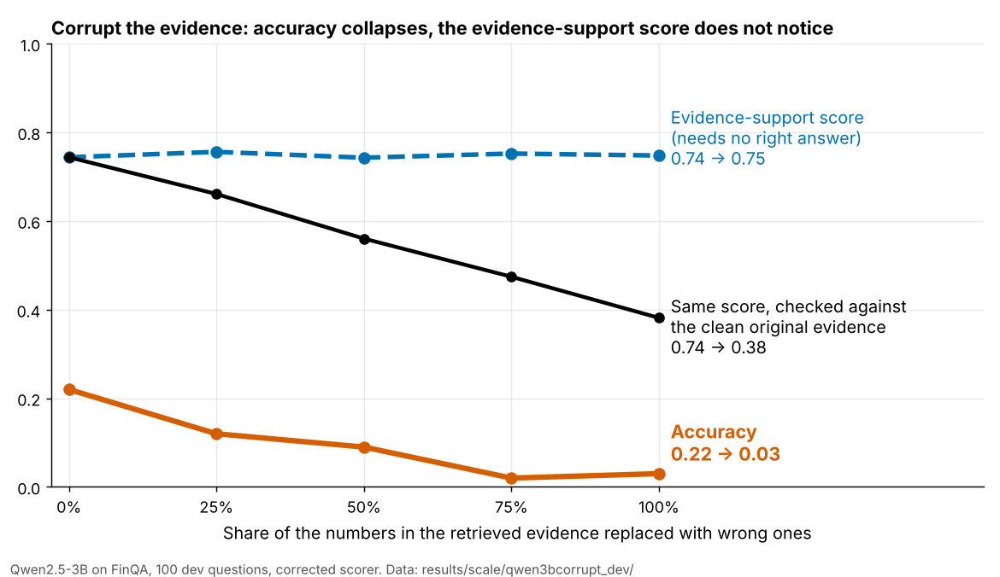

# Financial-NRF

**Can an AI's "reliability score" tell when the document it read was wrong?** Short answer: no.

> **In plain English**
>
> 1. AI tools that answer questions from company reports often attach a "reliability score" to each answer, without knowing the right answer.
> 2. Those scores mostly check one thing: does the answer match the text the AI was given?
> 3. So I tested what happens when the text is wrong. I replaced the numbers in the reports with wrong ones, on two public finance datasets and three open AI models.
> 4. The AI's accuracy collapsed, but the scores that need no right answer barely moved. Only a check against the original clean text caught the problem, and that needs the very thing the scores were meant to replace.
> 5. One example: accuracy fell from **0.22 to 0.03** when the evidence was corrupted (Qwen2.5-3B on FinQA; the other runs agree).



**[Paper draft (PDF)](paper/main.pdf)** · **[Live demo](https://aaronsunny007.github.io/Financial-NRF/)** · [Dissertation documents (release)](https://github.com/aaronsunny007/Financial-NRF/releases/tag/dissertation-docs-v1) · [Erratum](ERRATUM.md)

---

**A Numerical Reliability Framework for Retrieval-Augmented AI Systems**

MSc dissertation project — Ulster University
Aaron Prakash Gandi · Supervisor: Dr Tazar Hussain

The experiments were later extended and written up as an independent research paper (`paper/`), which corrects parts of the
submitted dissertation; `ERRATUM.md` lists every corrected claim.

**[Live demo](https://aaronsunny007.github.io/Financial-NRF/)**: score your own evidence and responses in the browser, browse the recorded results, and re-weight the composite yourself.

**Try it yourself.** On the demo page, the *Live analyser* scores any evidence and response you paste or load
from a file, and the *Ask a question* tab runs a Qwen2.5-Instruct model in your own browser (WebGPU,
desktop Chrome or Edge, about 2 GB the first time, nothing sent anywhere) and scores its answer. Questions
and test reports are welcome as [issues](https://github.com/aaronsunny007/Financial-NRF/issues/new/choose).
To run the scoring code and tests in a browser without installing anything, open the repo in
[GitHub Codespaces](https://codespaces.new/aaronsunny007/Financial-NRF).

---

## What this is

Language models are increasingly placed in front of financial documents and asked
numerical questions. The output is a number, not a paragraph, and somebody may act on
it. Existing benchmarks check only whether that final number matches a reference
answer. They do not ask whether the reasoning that produced it was grounded in the
retrieved evidence, whether the arithmetic the model described actually holds, or
whether its stated confidence means anything.

This project builds a measurement layer that asks those questions, applies it to a
retrieval-augmented question answering system over FinQA, and then attempts to falsify
its own headline metric.

**The finding, after the larger runs.** The composite reliability score is not a reliability
signal, but not for the reason first reported. In the original experiment the injected noise did
not hurt the model, so a flat score there proved nothing (the first version of this README said
otherwise). Once the evidence is genuinely corrupted, the composite does fall, but only through
its accuracy term and the calibration term that is itself a function of accuracy. The evidence-support
score, the entailment score and the hallucination flag, which are the parts that need no gold answer,
do not move at all, because they are measured against the evidence the model was shown. Measured against the
clean evidence, support does fall. See *What the larger runs show* below, `ERRATUM.md` for the
corrections to the submitted dissertation, and `results/scale/SUMMARY.md` for every table.

---

## The framework

Every generated answer is interrogated four ways:

| Check | Question it asks | Needs the gold answer? |
|---|---|---|
| **Execution accuracy** | Does the produced value match the executed gold program? | Yes |
| **Numerical evidence support** | Does every number in the answer trace back to the retrieved evidence, or a standard conversion of it? | No |
| **Post-hoc arithmetic verification** | Does the model's own stated calculation produce the number it claimed? | No |
| **Calibration (ECE)** | Does stated confidence match observed correctness? | No |

Three of the four need no reference answer, so they can run at inference time on a
question nobody knows the answer to. The arithmetic verifier is the most directly
deployable piece: it parses the expression the model wrote into a syntax tree and
evaluates it under a restricted evaluator permitting only numeric literals and the four
arithmetic operators — never `eval()` on model-generated text.

The four components combine into a composite score weighted `0.30 / 0.30 / 0.20 / 0.20`.
Those weights are assigned by judgement rather than learned, and that is the framework's
weakest design decision.

---

## What the larger runs show

After an audit found a scoring defect (see `ERRATUM.md`), the experiments were re-run on free CPU runners with the
corrected scorer, on far more items: Qwen2.5-3B on 150 dev and 150 test items, Qwen2.5-1.5B on 100 and 100,
a second model family (SmolLM2-1.7B), a corrupted-evidence variant on 100 and 100 per split, and three sampled-decoding
seeds. Every statistic carries a
bootstrap interval over items. Full tables are in `results/scale/SUMMARY.md`; code is
`experiments/scale_analysis.py`.

**1. The original noise manipulation does nothing.** Injecting up to four unrelated sentences changes none of
the measures. The paired change from 0% to 40% noise, per item, for Qwen2.5-3B:

| | accuracy | evidence support | hallucination flag |
|---|---|---|---|
| dev, n = 150 | +0.007 [−0.05, +0.07] | +0.009 [−0.01, +0.02] | −0.020 [−0.05, +0.01] |
| test, n = 150 | −0.027 [−0.07, +0.03] | −0.005 [−0.03, +0.02] | −0.013 [−0.05, +0.02] |

A flat composite under this noise is therefore the *correct* answer, not a failure. The original conclusion that the
score "does not track reliability when the evidence is degraded" was not established by Experiment 4.

**2. The five-point noise correlation, and the weight sweep built on it, are not reproducible.** For Qwen2.5-3B the
correlation between noise level and the composite is +0.09 on dev and −0.64 on test, each with a 95% interval of
about ±0.8. The share of the 1,771 weightings that pass both falsification tests is 0.0% on dev and 41.2% on test.
Weightings chosen on dev did not hold up on test for Qwen2.5-1.5B (56 passed both on dev, none on test). The earlier
statement that no re-weighting can rescue the composite is not supported by this data; neither is its opposite.

**3. Corrupt the evidence and the picture is clear.** Replacing a share of the numbers in the retrieved evidence with
wrong ones does degrade the model: accuracy falls from 0.22 to about 0.03 on both splits.

| Qwen2.5-3B, 0% to 100% corruption | dev (n = 100) | test (n = 100) |
|---|---|---|
| accuracy, paired change per item | −0.190 [−0.27, −0.12] | −0.190 [−0.28, −0.12] |
| composite, r with corruption level | −0.97 [−0.99, −0.82] | −0.93 [−0.98, −0.77] |
| evidence support vs the evidence shown | +0.004 [−0.02, +0.03] | −0.020 [−0.07, +0.02] |
| hallucination flag | +0.010 [−0.04, +0.06] | +0.020 [−0.03, +0.07] |
| entailment support (NLI) | +0.018 [−0.04, +0.08] | −0.069 [−0.13, −0.00] |
| evidence support vs the **clean** evidence | **−0.362 [−0.40, −0.33]** | **−0.376 [−0.42, −0.33]** |

The composite tracks corruption, but only because accuracy (which needs the gold answer) falls and the calibration term
follows it. The gold-free evidence measures cannot see the damage, because a model that faithfully repeats corrupted
numbers is, by that definition, well supported. Measured against a trusted source they do see it.

**4. Entailment is no better than numeric overlap.** Scoring each claim in the reasoning with an NLI model
(`experiments/entailment_scoring.py`) separates correct from incorrect answers no better than chance
(AUROC 0.52 on dev and 0.56 on test), and so does the overlap score, whose apparent 0.64 on dev (95% interval
0.53 to 0.73) is 0.51 on test.

**5. Other models and seeds agree that single numbers do not hold still.** On SmolLM2-1.7B (dev, n = 100) oracle evidence does beat
retrieval (accuracy 0.28 against 0.16), the correlation of noise with the composite is −0.81 [−0.97, +0.52], and 73.1% of weightings pass
both original tests, against 0.0% for Qwen2.5-3B on dev. Qwen2.5-1.5B sampled with three seeds gives noise correlations of +0.46, +0.52
and −0.37 (the greedy run gave −0.27) and clean accuracy of 0.31, 0.26 and 0.32 (greedy 0.40). Noise changes accuracy by +0.02, +0.05
and −0.11 per item across the three seeds; of eight noise-injection runs, one (the last seed, −0.22 to −0.01) has an interval that excludes
zero, so the manipulation's effect is at most small and inconsistent.

**6. A second dataset and larger models give the same answer.** The corrupted-evidence test was repeated on TAT-QA (Qwen2.5-3B on 100
dev and 100 test items, Qwen2.5-7B) and on FinQA with 4-bit Qwen2.5-7B and Llama-3.1-8B, run through llama.cpp on the same free CPU runners.
Accuracy at full corruption is 0.01 to 0.09 in every run. No measure that needs no gold answer (numeric overlap, entailment, lexical
groundedness, the hallucination flag, stated confidence) separates corrupted from clean evidence better than AUROC 0.58 in any single run,
while support measured against the clean evidence reaches 0.85 to 0.93. As detectors of wrong answers and of real retrieval misses, the
same measures are weak and change sign between smaller and larger models. All tables: `results/paper/ANALYSIS.md`; the write-up is `paper/main.pdf`.

**What remains true.** The framework's design critique stands and is now properly demonstrated: gold-free evidence
support, entailment and the hallucination flag are blind to corrupted evidence unless they are given a clean reference.
**What does not:** the claims that the composite fails to track noise, that no weighting works, and that the hallucination
flag tracks noise. **Limits:** small open models (1.5B to 8B), float32 on CPU or 4-bit through llama.cpp, FinQA and the arithmetic
subset of TAT-QA, 100 to 150 items per run.

---

## Recorded results (the original n = 50 GPU run)

These are the figures in the submitted dissertation. Read them with the corrections above.

All figures in this section are on 50 FinQA items per condition. Wilson confidence intervals are
reported throughout the accompanying documents.

| Measure | Value | Condition |
|---|---|---|
| Execution accuracy — ordinary retrieval | 0.340 | baseline |
| Execution accuracy — oracle evidence | 0.420 | gold evidence supplied |
| Composite score — ordinary retrieval | 0.5891 | ranked **first** by the composite |
| Composite score — oracle evidence | 0.5811 | ranked **second**, despite higher accuracy |
| Correlation, noise level vs composite | −0.10 | five graded levels, manipulation-checked; see the scoring defect below |
| Confidence gap, correct vs incorrect | 0.0239 | — |
| Overconfidence gap | 0.5560 | — |
| Errors made at high confidence | 0.6400 | — |
| Verifier outcomes | 56 / 20 / 12 / 12 | verified / ungrounded / no expression / self-contradictory (%) |

### Failure one — as originally reported (not established; see above)

Evidence was degraded across five graded noise levels, with a manipulation check
confirming the corrupted evidence actually reached the model. The correlation between
noise level and the composite score is −0.10: effectively no relationship.

The mechanism is structural rather than a coding defect. Evidence support is measured
*against the evidence supplied* rather than against truth, so a model that grounds
itself faithfully in corrupted passages still scores well. The verifier tests only
internal consistency, which a model can satisfy while working from nonsense. Calibration
is a property of the confidence report. Three of the four components are insensitive to
evidence quality by design, leaving only accuracy — 30% of the weight — to respond.

### Failure two — as originally reported (a tie in later runs; see above)

Supplying oracle evidence raised accuracy from 0.340 to 0.420, yet the composite ranked
that condition *lower*. A score whose purpose is to let you choose between systems chose
the worse one.

### Could different weights fix it? (as originally reported; not reproducible, see above)

The obvious objection is that the composite failed only because its hand-picked weights
were wrong. `experiments/weight_sensitivity.py` tests that directly. It re-scores the
saved Experiment 4 and 5 results under all 1,771 weightings on a 0.05 grid, with no
model re-run, and checks each weighting against both tests.

| Weightings that… | Share |
|---|---|
| track noise (r ≤ −0.5) | 19.2% |
| rank oracle > retrieval > closed-book | 43.5% |
| **do both** | **0.0%** |

Among the weightings that rank correctly, the strongest noise correlation is −0.16. The
two tests pull in opposite directions. Only hallucination rate (r = −0.76, as recorded; see the scoring defect below) and evidence
support (r = −0.37) respond to noise, but the oracle condition scores *worse* on both
(evidence support 0.628 vs 0.714, hallucination 0.20 vs 0.08), so its advantage shows
only in accuracy and calibration. Accuracy itself barely moves with noise (r = +0.10)
at n = 50. The failure belongs to the components, not the weights. A finer 0.01 grid
and looser thresholds give the same picture: with the threshold relaxed to r ≤ −0.3,
still no weighting passes.

### A scoring defect found after the runs

The evidence-support score counted the model's own `Confidence: 0.9` line as one more
number the evidence had to support. It never could, so every response was marked down
slightly and some were pushed under the hallucination threshold by that number alone.
The scorer is fixed (`exclude_confidence_from_support`, on by default, with tests), but
the recorded runs were scored the old way and have **not** been re-run.
`experiments/confidence_line_audit.py` measures the effect from the saved files.

| What | As recorded | Corrected |
|---|---|---|
| Exp 1 hallucination rate (strict NESS) | 0.08 | **0.00** |
| Exp 2 hallucination, clean → evidence injection | 0.10 → 0.20 | **0.00 → 0.00** |
| Oracle vs retrieval ONRS (default weights) | 0.5811 vs 0.5891 | 0.6211 vs 0.6224 |
| Weightings passing both tests | 0.0% | 0.0% in every scenario |
| Noise vs hallucination correlation | +0.76 | between +0.00 and +0.89 |
| Noise vs ONRS correlation (default weights) | −0.10 | between +0.18 and −0.36 |

What holds: the oracle-vs-retrieval ranking is still inverted, now as a near tie, and
no weighting passes both tests. What does not: the doubling of the hallucination rate in
Experiment 2 was this defect, and the two noise correlations cannot be pinned down
without re-running Experiment 4. Accuracy, calibration, the verifier and Experiment 3
do not use evidence support and are unaffected. The Experiment 4 figures are bracketed
rather than exact because that run did not save its responses; the bracketing method is
checked against the 150 Experiment 5 rows where the exact answer is known.

### Measured re-run with the corrected scorer

The estimates above were then checked by actually re-running all five experiments with the
corrected scorer, for free, on GitHub-hosted CPU runners (`.github/workflows/cpu-rerun.yml`,
outputs in `results/cpu_fp32/`). It is the same model and pipeline in float32 rather than
4-bit, so individual answers differ (15 of 50 baseline answers are identical), and accuracy
came out lower. Read it as a replication on different numerics, not a regeneration.

| Measure | Recorded (4-bit GPU, old scorer) | Re-run (float32 CPU, corrected scorer) |
|---|---|---|
| Execution accuracy, retrieval | 0.340 | 0.200 |
| Execution accuracy, oracle evidence | 0.420 | 0.200 |
| Hallucination rate, retrieval | 0.08 | 0.06 |
| Composite, retrieval vs oracle | 0.5891 vs 0.5811 | 0.5425 vs 0.5316 |
| Noise vs composite, r | −0.10 | **+0.62** |
| Noise vs hallucination rate, r | +0.76 | **−0.12** |
| Weightings that track noise (r ≤ −0.5) | 19.2% | 0.1% |
| Weightings that pass both tests | 0.0% | 0.0% |

What replicated: the composite does not track noise (it moved the other way, because
accuracy drifted up with noise by chance, 0.20 to 0.28), and no weighting passes both
tests. What did not: the hallucination flag does not follow noise (0 to 3 flagged
responses per level, no trend), so the earlier +0.76 should not be relied on. Oracle
evidence did not beat retrieval in this run (both 0.200), so the ranking inversion
cannot be tested here; the composite still scored oracle lower. The 14-point drop in
accuracy from changing only numeric precision is itself a measure of how unstable a 3B
model's answers are at n = 50. A 4-bit GPU re-run is the one remaining like-for-like check.

### What the oracle comparison establishes

In the recorded run, perfect evidence lifts accuracy only to 0.420 (it did not help at all
in the float32 re-run), placing the majority of the residual error in numerical reasoning
rather than retrieval. That decomposition is the useful
result: it says where future work should go.

---

## Repository layout

```
data_loader/      FinQA loading and preparation (dataset files not committed)
rag_pipeline/     Retrieval and generation: embeddings, FAISS index, prompt assembly
framework/
  nrf.py          The four measurements and the composite score
  verifier.py     Gold-free arithmetic verification via restricted AST evaluation
experiments/
  experiment1.py  Baseline evaluation
  experiment2.py  Adversarial injection (clean / document / evidence conditions)
  experiment3.py  Confidence calibration and overconfidence decomposition
  experiment4.py  Noise sensitivity across five graded levels
  experiment5.py  Oracle evidence vs ordinary retrieval — the ranking inversion
  finqa_gold.py   Shared gold-answer resolution, with its own test suite
  weight_sensitivity.py  Re-scores saved results under every ONRS weighting (no GPU)
  confidence_line_audit.py  Measures the confidence-line scoring defect from saved results (no GPU)
results/          Per-item CSV output and summary JSON for every run
deploy/           Gradio results explorer (Hugging Face Space), optional live pipeline
index.html        Static browser demo: live scoring, recorded results, weight sweep
```

Per-item CSVs are committed deliberately: every figure quoted above can be traced back
to the individual answers it came from.

---

## Setup

```bash
python -m venv venv
venv\Scripts\activate          # Windows
# source venv/bin/activate     # macOS / Linux

pip install -r requirements.txt
```

FinQA is not redistributed here. Download `train.json`, `dev.json` and `test.json` from
[the FinQA repository](https://github.com/czyssrs/FinQA) and place them in `data_loader/`.

Developed against Python 3.11. A CUDA GPU is required for 4-bit quantised inference.

## Running the experiments

```bash
python -m experiments.experiment1 --n 50
python -m experiments.experiment3 --n 50
python -m experiments.experiment4 --n 50 --injection-mode evidence
python -m experiments.experiment5 --n 50
```

Each writes a per-item CSV and a summary JSON into `results/`.

No GPU? The **cpu-rerun** workflow (Actions tab, Run workflow) re-runs all five on free
GitHub-hosted CPUs in full precision, in about two hours, and commits the results to a new
branch. It shards the generation step, then replays the answers through the unchanged
experiment scripts (`--engine replay`). Set `replay_only` to re-score the committed
`results/cpu_fp32/generations.jsonl` without regenerating.

The weight-sensitivity sweep and the test suites need only `numpy`, not a GPU:

```bash
pip install -r requirements-dev.txt
python -m framework.nrf                    # parsing and evidence-support tests
python -m framework.verifier               # arithmetic verifier tests
python -m experiments.finqa_gold           # gold-answer resolution tests
python -m experiments.weight_sensitivity   # re-score saved results under every weighting
python -m experiments.confidence_line_audit  # measure the confidence-line defect
```

CI runs all five on every push and checks that the sweep and the audit reproduce the
committed results.

---

## Stack, and why

| Component | Choice | Reason |
|---|---|---|
| Dataset | FinQA | Ships the executable calculation program per item, not just the answer — which is what makes gold-free verification and the oracle condition possible |
| Embeddings | `all-MiniLM-L6-v2` | Fast on consumer hardware; the oracle experiment confirms retrieval is not the bottleneck |
| Vector search | FAISS `IndexFlatIP` | Exact cosine search, so approximation error cannot confound the results |
| Generator | Qwen2.5-3B-Instruct | Open weights and fully local, so no hosted model can change between runs |
| Quantisation | 4-bit NF4 (bitsandbytes) | Required to fit the model on the available GPU (RTX 3050) |
| Verification | Python `ast` | Parse-and-walk with a restricted node whitelist — never `eval()` on generated text |
| Intervals | Wilson score | Well-behaved at n = 50 and near the bounds, unlike the normal approximation |

---

## Limitations

- **Model scale is a constraint, not a result.** The generators are 1.5B to 8B parameters (float32 on CPU up to 3B,
  4-bit through llama.cpp for the 7B and 8B models, so size is confounded with precision). Absolute accuracy would rise
  with scale. Nothing above 8B was tested.
- **100 to 150 items per run, two datasets.** FinQA and the arithmetic questions of TAT-QA. Enough to separate large effects (corruption halves accuracy) from none, not
  to resolve differences of a few points; every statistic carries a bootstrap interval for that reason.
- **Five noise levels make a poor correlation.** The Pearson r over five level averages has an interval of about ±0.8
  at these sizes. The item-level paired effects are the statistics to trust.
- **Greedy decoding is deterministic, so "seeds" mean sampled decoding.** The seed runs sample at temperature 0.7 with
  Qwen2.5-1.5B; the greedy runs have no seed variance to report.
- **Evidence support is numerical overlap**, and the entailment alternative (a small NLI model) did no better. Neither
  sees corruption of the evidence it is given; only a trusted reference does.
- **The corrupted-evidence test is synthetic.** Numbers are replaced by scaled versions of themselves. It shows what the
  measures *can* detect, not how often real retrieval errors look like this.
- **The composite weighting is assigned, not learned.** Whether some weighting works could not be settled with five-point
  correlations; the corruption experiment shows the useful signal is accuracy, calibration-through-accuracy, and support
  measured against a clean reference.
- **The original recorded runs predate a scoring fix** (see `ERRATUM.md`). They are kept for provenance.

---

## Documents

| File | Contents |
|---|---|
| [`paper/main.pdf`](paper/main.pdf) | The research paper draft (ACL format); sources in `paper/`, arXiv notes in `paper/ARXIV.md` |
| [Release `dissertation-docs-v1`](https://github.com/aaronsunny007/Financial-NRF/releases/tag/dissertation-docs-v1) | The three Word documents, kept out of the repository tree: `NRF_Report_IEEE_v3.docx` (the report, IEEE two-column), `NRF_Supporting_Evidence_v3.docx` (supporting evidence and extended methodology) and `NRF_Erratum.docx` (corrections, with the evidence) |
| `NRF_Experimental_Chapter.md` | The experimental chapter in full |
| `ERRATUM.md` | Corrections to the submitted dissertation, with the evidence |
| `results/scale/SUMMARY.md` | Tables from the larger runs |
| `results/paper/ANALYSIS.md` | Tables behind the paper: corrupted-evidence detection, error detection, retrieval misses |
| `docs/STUDY_GUIDE.md` | A step-by-step walkthrough of `scale_analysis.py` and `entailment_scoring.py` |

---

## How this was built

Much of the code, the analysis scripts and the first drafts of the write-ups were produced with the help of an AI coding
assistant (Claude, via Claude Code); the commit history shows which commits those were. The research questions, the
decisions about what to test and what to withdraw, and responsibility for every claim are the author's. Every number in the
paper is generated from the result files in this repository by the scripts here, so each can be re-run and checked.

---

## Licence

MIT — see [`LICENSE`](LICENSE).
